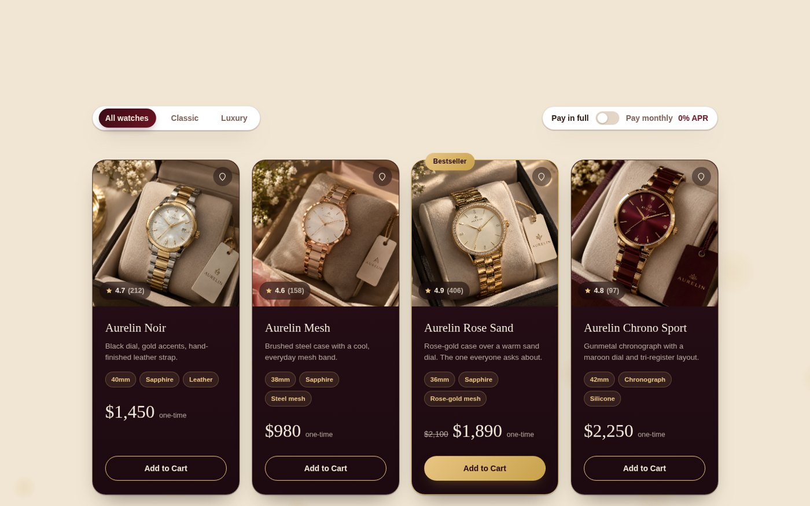
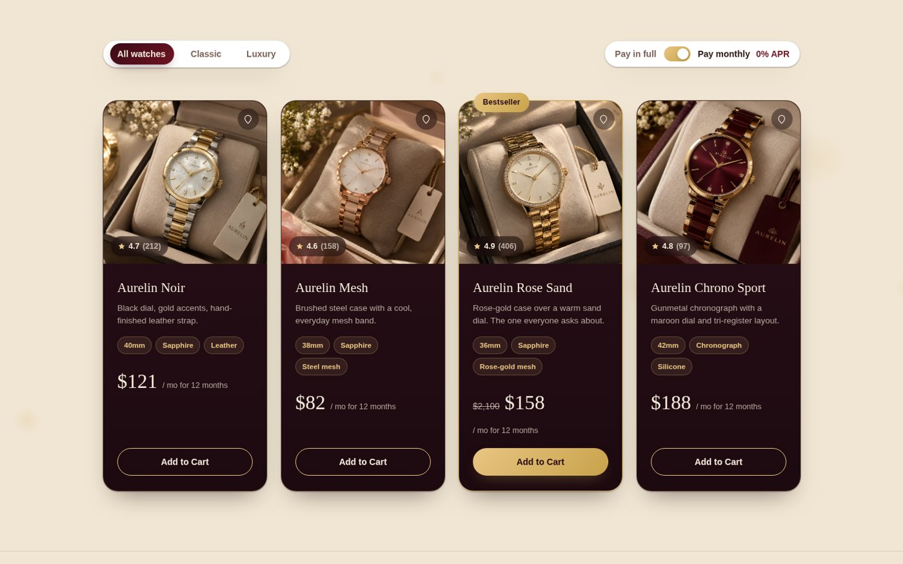
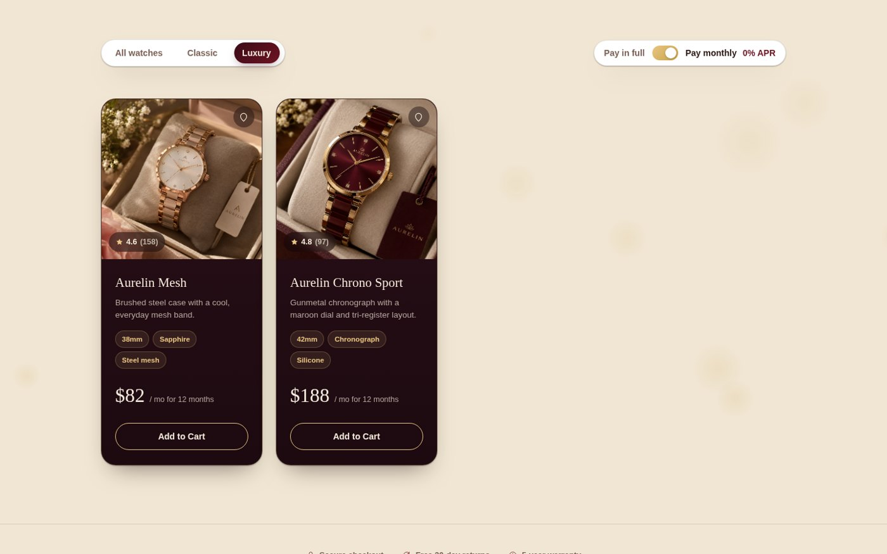

# Aurelin Timepieces: Interactive Product Cards with Filter & Toggle

An interactive product section for a fictional watch brand, built with **HTML, CSS and JavaScript** as **Task 2** of the **Internify Frontend Development Internship**.




## Features
- 4 product cards, each with image, title, description, feature tags, price and a CTA button
- **Pay in full / Pay monthly toggle** (JavaScript) that updates the price on every card dynamically
- **Category filter** (All watches / Classic / Luxury) that shows and hides cards using JavaScript
- One card highlighted with a **Bestseller** badge and distinct styling
- Hover animations (card lift, shadow, border glow) using CSS transitions
- Micro-interactions: active state on filter buttons and button click feedback
- Responsive layout using CSS Grid and Flexbox

## Screenshots
| Pay monthly selected | Luxury filter applied |
|---|---|
|  |  |

## Tech Stack
HTML5 · CSS3 (Grid, Flexbox, transitions) · Vanilla JavaScript (DOM manipulation, event listeners)

## Project Structure
```
project2/
├── index.html
├── style.css
├── script.js
└── images/
```

## Run Locally
```bash
git clone https://github.com/<your-username>/<repo-name>.git
cd <repo-name>
# open index.html in your browser, or use the VS Code "Live Server" extension
```

## What I Learned
JavaScript DOM manipulation, dynamic content updates, event listeners and building interactive UI components.

## Author
**S Fatima Manzoor**

---
Built for the **Internify** Frontend Development Internship.
