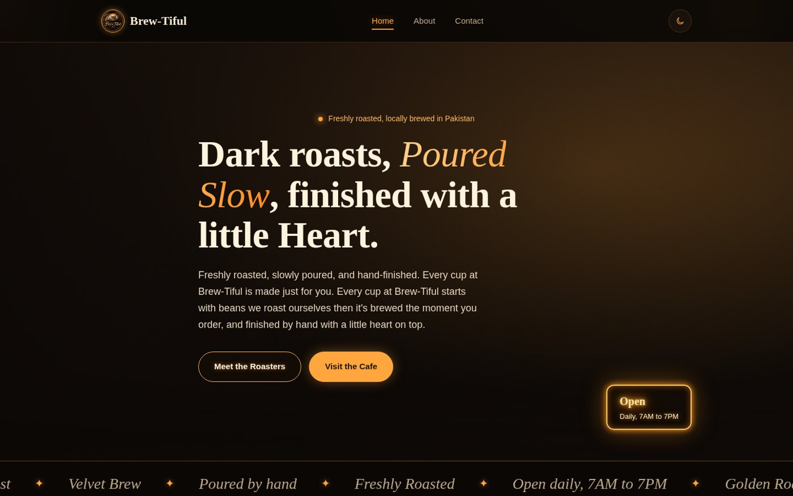
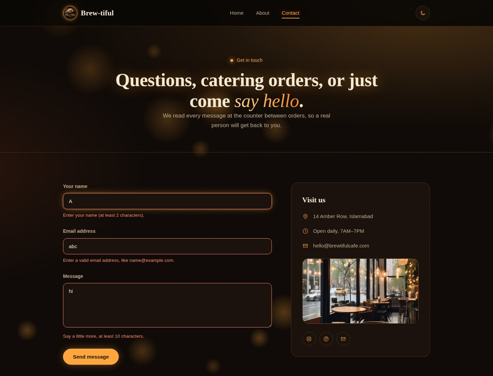
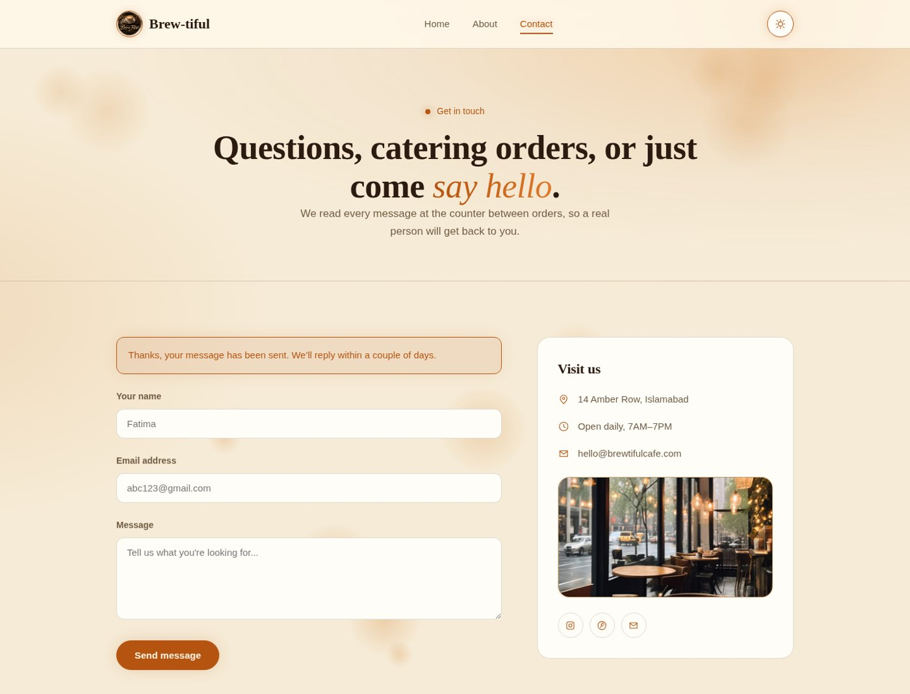

# Brew-Tiful: Multi-Page Website with Mobile Navigation & Form Validation

A 3-page website (Home, About, Contact) for a fictional coffee house, built with **HTML, CSS and JavaScript** as **Task 3** of the **Internify Frontend Development Internship**.



## Live Demo
🔗 [Add your GitHub Pages link here]

## Features
- 3 linked pages (**Home, About, Contact**) with a consistent navbar and footer
- **Mobile hamburger menu** built with JavaScript, with a smooth animated drawer
- **Contact form validation** with an error message under each field:
  - Name: required, minimum 2 characters
  - Email: must match a valid email format
  - Message: required, minimum 10 characters
- Success message on valid submission (front-end only, no backend)
- **Dark / light mode toggle** that remembers your choice (saved in the browser)
- Responsive design for mobile, tablet and desktop

## Screenshots
| Form validation | Light mode |
|---|---|
|  |  |

## Tech Stack
HTML5 · CSS3 (custom properties for theming, transitions) · Vanilla JavaScript (DOM handling, form validation, localStorage)

## Project Structure
```
project3/
├── index.html
├── about.html
├── contact.html
├── style.css
├── script.js
└── images/
```

## Run Locally
```bash
git clone https://github.com/<your-username>/<repo-name>.git
cd <repo-name>
# open index.html in your browser, or use the VS Code "Live Server" extension
```

## What I Learned
Multi-page project structure, advanced DOM handling, form validation logic and improving UX with theme switching.

## Author
**S Fatima Manzoor**

---
Built for the **Internify** Frontend Development Internship.
