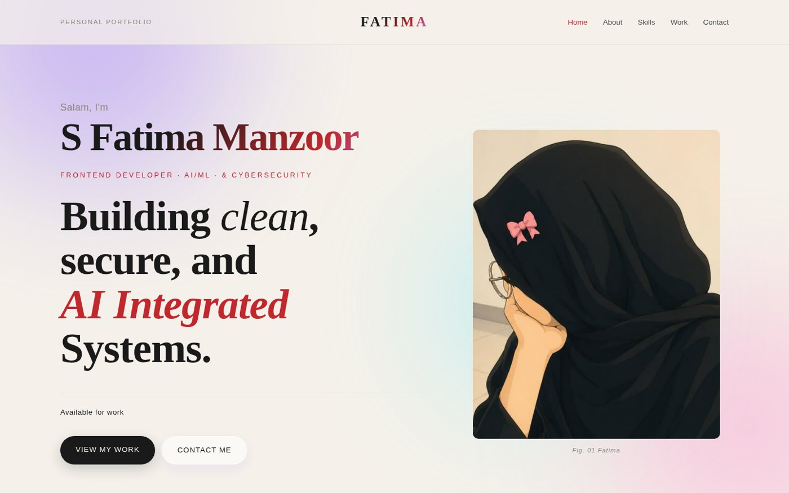
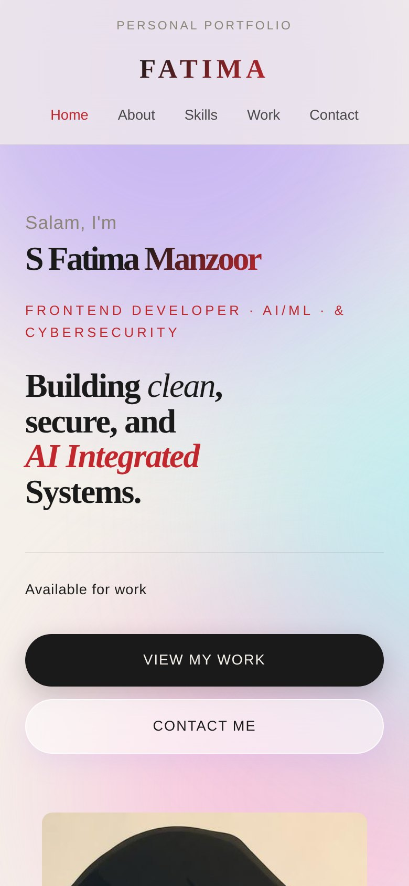

# Responsive Personal Portfolio Website

A fully responsive personal portfolio built with **HTML, CSS and JavaScript** as **Task 1** of the **Internify Frontend Development Internship**.



## Live Demo
🔗 [Add your GitHub Pages link here]

## Features
- Navbar with name and links (Home, About, Skills, Work, Contact) with **smooth scrolling** and active-link highlighting
- **About Me** section with a short bio and profile picture
- **Skills** section with 12 skills shown as animated progress bars
- **Selected Work** section with 4 project cards (image, title, description, tech tags)
- **Contact** section with a styled form (name, email, message) and social media links
- Fade-in-on-scroll animations, hover effects and a scrolling marquee
- Fully responsive for mobile, tablet and desktop with no horizontal scrolling

## Tech Stack
HTML5 · CSS3 (Grid, Flexbox, transitions, animations) · Vanilla JavaScript (IntersectionObserver)

## Project Structure
```
project1/
├── index.html
├── style.css
├── script.js
└── images/
```

## Run Locally
```bash
git clone https://github.com/<your-username>/<repo-name>.git
cd <repo-name>
# open index.html in your browser, or use the VS Code "Live Server" extension
```

## Mobile View


## Author
**S Fatima Manzoor**

---
Built for the **Internify** Frontend Development Internship.
